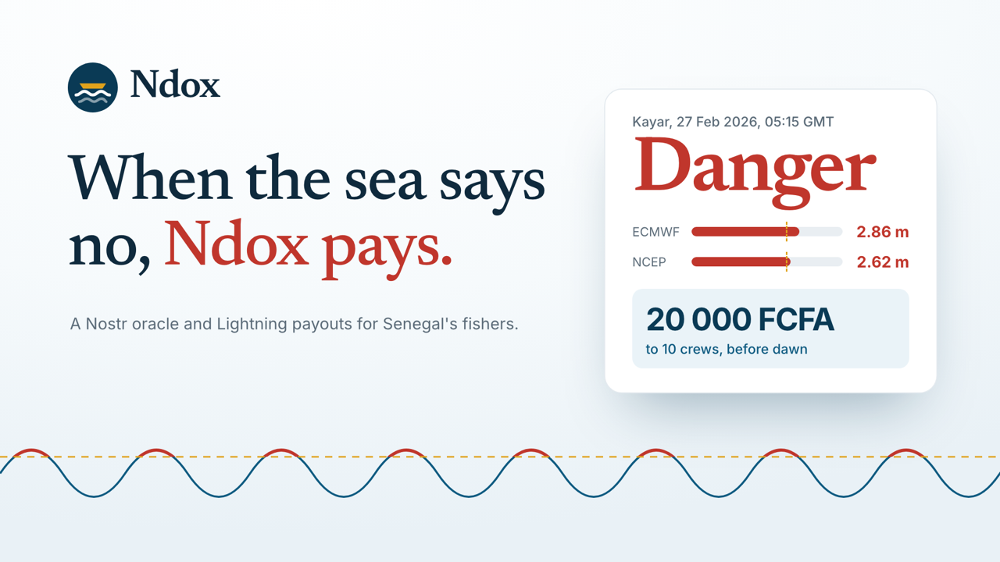
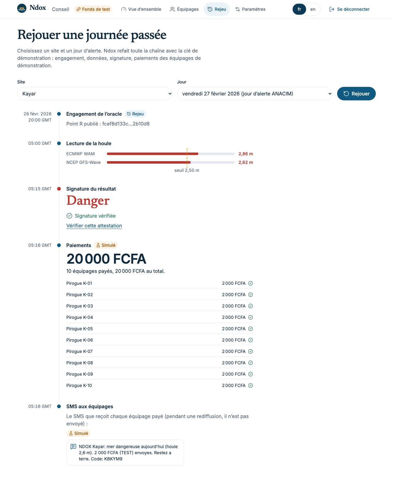
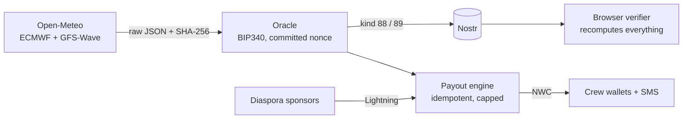

<p align="center"></p>

<h1 align="center">Ndox</h1>

<p align="center"><b>Quand la mer dit non, Ndox paie.</b><br><i>When the sea says no, Ndox pays.</i></p>

<p align="center">
  <a href="#video">Video</a> ·
  <a href="https://ndox-production.up.railway.app">Live app</a> ·
  <a href="#how-it-works">How it works</a> ·
  <a href="#run-it">Run it</a> ·
  <a href="#honest-limits">Limits</a>
</p>

Ndox is preventive solidarity for Senegal's artisanal fishers. When two independent wave models agree that the sea will be too dangerous, a Nostr oracle signs it at dawn and the fishing council's common pool pays every covered crew 2 000 FCFA over Lightning, so nobody has to risk the sea for that day's income. Anyone can check the proof in their browser.

**Built for Dakar Bitcoin Hack 2026 (Btrust).** Live at **https://ndox-production.up.railway.app** (Lightning test network: real payments, sats with no value).

<a id="video"></a>

<p align="center"><a href="docs/assets/video-thumbnail.png"></a><br><sub>▶ Demo video — link coming</sub></p>

<p align="center"><br><sub>The council replays 27 Feb 2026 at Kayar: both models above 2.5 m, "danger" signed at 05:15, 10 crews paid, SMS sent.</sub></p>

---

## The problem

- In 2017, 181 fishers died at sea in Senegal, according to the fisheries protection service (DPSP), quoted by [Ndarinfo](https://www.ndarinfo.com/En-2017-la-mer-a-tue-181-pecheurs-au-Senegal_a20849.html). In the Saint-Louis region alone, fishing organisations counted 218 deaths between 2018 and March 2026 ([Senego](https://senego.com/218-morts-recenses-dans-une-seule-region-lultimatum-des-acteurs-de-la-peche-adresse-au-chef-de-letat_1943659.html)).
- ANACIM issues swell alerts, but crews often go out anyway: a day ashore is a day without income. Fishing councils (CLPA) already pool money; in Kayar, 200 FCFA per pirogue fuel purchase goes to the council ([CFFA](https://www.cffacape.org/news-blog/clpa-comanagement-preserve-marine-ecosystem-senegal)).
- Parametric fisheries cover exists, but it pays governments within 14 days ([World Bank, COAST](https://www.worldbank.org/en/news/feature/2019/09/20/innovative-fisheries-insurance-benefits-caribbean-fisherfolk)), not the crew on the morning of the storm.

Ndox is the council's own mutual pot, made automatic and paid before the danger. It is not an insurance company.

## How it works

| Time (GMT)           | What happens                                                                                      |
| -------------------- | ------------------------------------------------------------------------------------------------- |
| 20:00 the day before | The oracle publishes a **commitment** on Nostr (kind 88): the nonce `R` it will sign with.        |
| 05:00                | It fetches the 06:00–18:00 forecast from **ECMWF WAM and NCEP GFS-Wave** and hashes the raw data. |
| 05:15                | **Both** models above 2.5 m → `danger`; it signs the outcome with the committed nonce (kind 89).  |
| Right after          | On `danger`, the pool pays every eligible crew over Lightning (NWC), within a daily cap.          |
| Then                 | SMS to each paid crew; `/e/CODE` (30 KB, no script) and USSD for status.                          |



## Why the oracle can't lie

1. At 20:00 the oracle commits to `R = k·G` for tomorrow, before the data exists.
2. At 05:15 it signs the outcome with that nonce: `s = k + e·x`.
3. Signing a second outcome with the same `R` reveals its private key: `x = (s − s') / (e − e')`.

`/verifier/:id` re-checks the signature, the commitment, the raw-data hashes, the rule and every payout preimage in your browser, and runs the key-recovery attack on a throwaway key. Tests: [packages/oracle/src/crypto.test.ts](packages/oracle/src/crypto.test.ts).

## Try it on the live app

1. [`/verifier`](https://ndox-production.up.railway.app/verifier): open a signed event; every check is recomputed in the browser.
2. [`/soutenir`](https://ndox-production.up.railway.app/soutenir): sponsor a crew, pay the invoice with the test wallet, get a receipt.
3. [`/e`](https://ndox-production.up.railway.app/e): a crew's status page by 6-character code.
4. `/conseil/rejeu` (council login): replay 27 Feb 2026 at Kayar end to end.

## Run it

```sh
cp .env.example .env && docker compose up
# open http://localhost:8080 (simulated wallet + demo crews, works offline)
docker compose exec ndox node dist/cli.js replay --site kayar --date 2026-02-27
docker compose exec ndox node dist/cli.js admin-password   # council login for /conseil
```

Development: `pnpm install && pnpm typecheck && pnpm lint && pnpm test && pnpm build && pnpm e2e`.

## Real vs simulated

- **Real:** wave data (Open-Meteo), signatures, Nostr events, in-browser verification.
- **Real Lightning on a test network:** sponsor invoices, pool and payouts (Alby NWC faucet wallets), labelled **Fonds de test**.
- **Simulated, labelled Simulé:** SMS and mobile-money cash-out. Crews are demo crews; no real fisher is enrolled. Replays use a separate key and a simulated wallet.
- **AI:** the sea bulletin is written only from signed facts (template fallback); the rules explainer is given only `/api/rules`.

Full table: [docs/REAL_VS_SIMULATED.md](docs/REAL_VS_SIMULATED.md).

## Honest limits

- **Basis risk:** a grid-cell forecast is not the beach. At 2.5 m the live rule matches 2 of 25 press-reported ANACIM alert days; calibrating the threshold with each council is a pilot's first job.
- **One data provider** (Open-Meteo) for both models.
- **Custody:** one Lightning wallet held by the server; an on-chain DLC is on the roadmap.
- **Regulation:** scaling needs a licensed partner in the CIMA zone.

Threat model: [docs/THREAT_MODEL.md](docs/THREAT_MODEL.md) · Architecture: [docs/ARCHITECTURE.md](docs/ARCHITECTURE.md) · Decisions: [docs/DECISIONS.md](docs/DECISIONS.md)

## AI use

Code, tests and docs were written with an AI coding assistant (Anthropic's Claude), directed by the team. In the product, the model never touches money, keys or crew data; the live site uses OpenAI `gpt-4o-mini`.

## Licence

MIT. Wave data: [Open-Meteo Marine API](https://open-meteo.com/en/docs/marine-weather-api).
