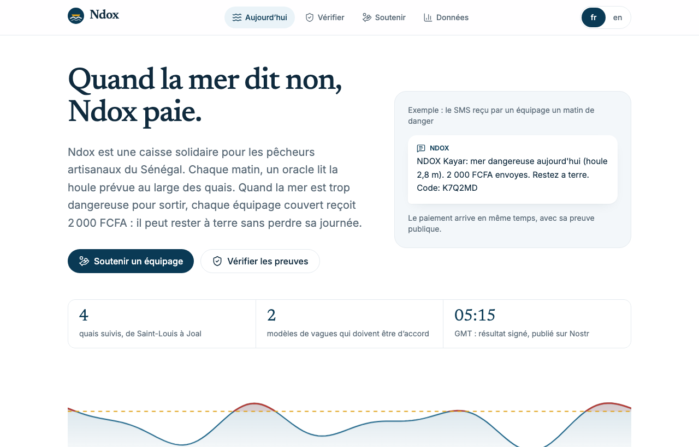
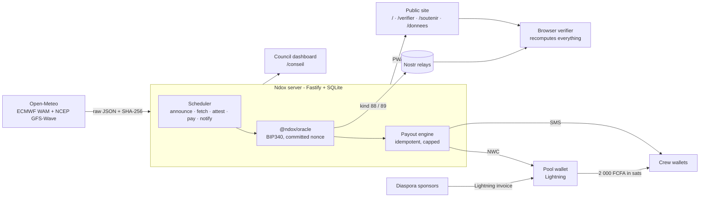
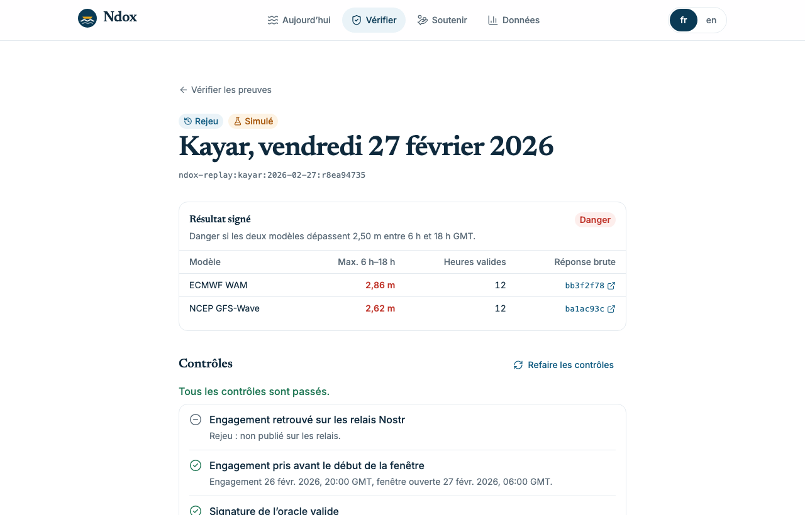
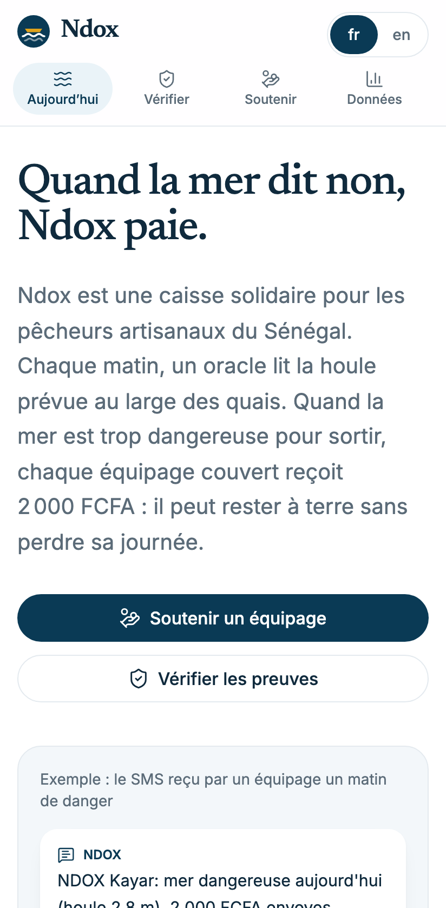

# Ndox

**Quand la mer dit non, Ndox paie.** _When the sea says no, Ndox pays._

Ndox is preventive solidarity for Senegal's artisanal fishers. When two independent wave models agree that the sea will be too dangerous, a Nostr oracle signs it at dawn and the fishing council's common pool pays every covered crew 2 000 FCFA over Lightning. Nobody has to risk the sea for that day's income.

- **Live:** https://ndox-production.up.railway.app (Lightning test network: real payments, sats with no value)
- **Video (3 min):** _link added after recording_
- **Built for:** Dakar Bitcoin Hack 2026 (Btrust)



## Quick start

```sh
cp .env.example .env && docker compose up
# open http://localhost:8080 (simulated wallet + seed data, works offline)
```

Replay a real alert day end to end: the oracle's commitment, both wave models, the signature, the payouts and the SMS.

```sh
docker compose exec ndox node dist/cli.js replay --site kayar --date 2026-02-27
# or, from a dev checkout: pnpm install && pnpm replay --site kayar --date 2026-02-27
```

The first start enrols demo crews (`SEED_DEMO`, simulated wallet only), so the replay pays them. You can also run it in the browser: open `/conseil/rejeu`, log in with the password printed by `docker compose exec ndox node dist/cli.js admin-password`, and press **Rejouer**.

## The problem

Artisanal fishing feeds Senegal, and the sea kills the people who do it.

- In 2017, 181 fishers died at sea, according to the head of the fisheries protection service (DPSP), quoted by [Ndarinfo](https://www.ndarinfo.com/En-2017-la-mer-a-tue-181-pecheurs-au-Senegal_a20849.html). The DPSP's 2017 report counts 92 accidents and 140 deaths ([Greenpeace Africa](https://www.greenpeace.org/africa/en/press/4193/loss-of-lives-at-sea-greenpeace-calls-on-the-senegalese-government-to-improve-safety-at-sea-for-small-scale-artisanal-fishermen/)).
- In the Saint-Louis region alone, fishing organisations counted 359 accidents, 218 deaths and 79 missing between 2018 and March 2026 ([Senego](https://senego.com/218-morts-recenses-dans-une-seule-region-lultimatum-des-acteurs-de-la-peche-adresse-au-chef-de-letat_1943659.html)).
- The met agency, ANACIM, issues dangerous-swell alerts (for example its special bulletin of 24 February 2026 for the Grande Côte: waves "pouvant dépasser 2,5 m"). Crews often go out anyway, because a day ashore is a day without income.
- Fishing councils (CLPA) already pool money. In Kayar, 200 FCFA is retained on every pirogue fuel purchase for the council's account ([CFFA](https://www.cffacape.org/news-blog/clpa-comanagement-preserve-marine-ecosystem-senegal)).
- Parametric fisheries cover exists, but it is sold to governments. The Caribbean's COAST facility (CCRIF and World Bank, 2019) pays a government within 14 days ([World Bank](https://www.worldbank.org/en/news/feature/2019/09/20/innovative-fisheries-insurance-benefits-caribbean-fisherfolk)). It does not pay the crew on the morning of the storm.

**A crew member's day, before:** the swell alert is on the radio, but there is no money at home, so the pirogue goes out.

**After:** at 05:15 the oracle signs "danger" for Kayar. A few minutes later the crew gets an SMS: _NDOX Kayar: mer dangereuse aujourd'hui (houle 2,8 m). 2 000 FCFA envoyes. Restez a terre._ The money is already in their wallet, and anyone can check the proof.

This is the council's own mutual pot, made automatic and paid before the danger. It is not an insurance company. A licensed insurer is the path to scale (see the roadmap).

## How it works

| Time (GMT)           | What happens                                                                                                                                                                                                                              |
| -------------------- | ----------------------------------------------------------------------------------------------------------------------------------------------------------------------------------------------------------------------------------------- |
| 20:00 the day before | For each landing site, the oracle publishes a **commitment** on Nostr (kind 88): the nonce point `R` it will sign with tomorrow.                                                                                                          |
| 05:00                | It fetches the 06:00–18:00 forecast from **two wave models**, ECMWF WAM and NCEP GFS-Wave (via Open-Meteo), and stores the raw responses and their SHA-256.                                                                               |
| 05:15                | Rule: if **both** models exceed the site's threshold (2.5 m) the day is `danger`; if either model has fewer than 10 valid hours it is `indisponible`; otherwise `calme`. The oracle signs the outcome with the committed nonce (kind 89). |
| Right after          | If `danger`, the pool pays every eligible crew at that site over Lightning (NWC), stores each payment's preimage, and publishes a receipt.                                                                                                |
| Then                 | SMS to each paid crew; the crew can also check `/e/CODE` (a 30 KB page with no script) or the USSD menu. A sea bulletin is posted on the home page and on Nostr.                                                                          |



Repo layout: `packages/oracle` (sign and verify; no server dependencies), `packages/shared` (rules, schemas, money helpers), `apps/server` (API, scheduler, wallet, SMS/USSD, AI), `apps/web` (public site and council dashboard). See [docs/ARCHITECTURE.md](docs/ARCHITECTURE.md).

## Why the oracle can't lie

The oracle has key `x` (public `P = x·G`). The evening before, it commits to `R = k·G` for tomorrow's event. At dawn it signs outcome `m` (BIP340):

```
s = k + e·x   where   e = H(R ‖ P ‖ m)
```

If it ever signed a second outcome `m'` with the same `R`, then `s − s' = (e − e')·x`, so anyone can compute **`x = (s − s') / (e − e')`**. A second answer publishes the private key. The commitment is public before the data exists, so the oracle can't pick a convenient story afterwards.

`/verifier/:id` re-runs, in your browser: `s·G = R + e·P`, the nonce matches the commitment, the commitment predates the window, the raw-data hashes match Open-Meteo, the rule gives the same outcome, and `sha256(preimage) = payment_hash` for every payout. The page also lets you sign "calme" and "danger" with the same `R` using a throwaway key, and shows that key being recovered.

Tests: [packages/oracle/src/crypto.test.ts](packages/oracle/src/crypto.test.ts) (official BIP340 vectors; the `equivocation` suite recovers the key from two signatures).

## Real vs simulated

Anything simulated carries a **Simulé** badge, and money on the test network carries a **Fonds de test** badge. Full table: [docs/REAL_VS_SIMULATED.md](docs/REAL_VS_SIMULATED.md).

| Part                                                                      | Live deployment                                                                                                 |
| ------------------------------------------------------------------------- | --------------------------------------------------------------------------------------------------------------- |
| Wave data (Open-Meteo), signatures, Nostr events, in-browser verification | **Real**                                                                                                        |
| Lightning payments (sponsor invoices, pool, payouts)                      | **Real Lightning on a test network** (Alby NWC faucet wallets): real invoices and preimages, sats with no value |
| Crews                                                                     | **Demo crews** only, labelled _Démo_. No real fisher is enrolled.                                               |
| SMS                                                                       | **Simulated** (console, phone masked); Africa's Talking sandbox supported                                       |
| USSD                                                                      | Africa's Talking **sandbox**; no short code rented                                                              |
| Mobile-money cash-out (Wave, Orange Money)                                | **Simulated**, interface only                                                                                   |
| Replays of past days                                                      | **Rejeu**: separate demo key, `ndox-replay` tag, simulated wallet                                               |
| Sea bulletin and rules explainer                                          | **AI** (OpenAI `gpt-4o-mini` on the live site), with guards described below                                     |

## Security by design

The full table is in [docs/THREAT_MODEL.md](docs/THREAT_MODEL.md). In short:

- **Separate keys:** the oracle key signs facts and never touches money; the pool key signs receipts; the wallet is an NWC connection with a spending budget. Replays use a third key.
- **Payouts are idempotent:** one payout per policy per attestation, enforced by the database, and the wallet is asked whether an invoice was paid before anything is resent. They are capped per day by the app (`DAILY_PAYOUT_CAP_SATS`), and go only to the Lightning address registered when the crew was enrolled; no API changes it.
- **72-hour waiting period**, so nobody can buy cover after seeing the forecast.
- **No personal data** on Nostr or in logs (tokens in URLs are redacted; a test greps the logs for phone numbers and addresses). Phone numbers and Lightning addresses are encrypted at rest.
- **Council dashboard:** hashed password, httpOnly cookie, CSRF token, Origin check, rate-limited login.
- **Strict CSP**, HSTS, `frame-ancestors 'none'`, rate limits on public endpoints, daily SQLite backups, and health-check pings after each job when `HEALTHCHECK_URL` is set.

### Honest limits

- **Basis risk.** The forecast for a grid cell is not the beach. See the alert-day match below: this is the main open problem.
- **One data provider.** Both models come through Open-Meteo (free for non-commercial use).
- **Custody.** The pool sits in one Lightning wallet controlled by the council's server. An on-chain DLC is on the roadmap.
- **Regulation.** We frame this as the council's own mutual fund. CIMA rules apply to insurance, so scaling means a licensed partner.
- **Cash-out** to Wave or Orange Money is simulated.

## Backtest and alert-day match

ERA5-Ocean reanalysis, 1995–2025, threshold 2.5 m, window 06:00–18:00 ([data/seed/backtest.json](data/seed/backtest.json), `pnpm backtest`; charts on `/donnees`):

| Site                    | Danger days per season (mean / p90 / worst) | Weekly premium for 2 000 FCFA per danger day |
| ----------------------- | ------------------------------------------- | -------------------------------------------- |
| Kayar (Dec–Jun)         | 12.2 / 19 / 26                              | 1 006 FCFA                                   |
| Saint-Louis (Guet Ndar) | 14.3 / 21 / 32                              | 685 FCFA                                     |
| Soumbédioune (Dakar)    | 3.0 / 6 / 8                                 | 143 FCFA                                     |
| Joal-Fadiouth           | 0.1 / 0 / 1                                 | 5 FCFA                                       |

The live two-model rule over the last year (Nov 2025 – Nov 2026) fires at Kayar on 4 days, including 27 Feb 2026, the day in the demo.

**Alert-day match (the honest number).** We collected 26 site-days covered by ANACIM swell alerts reported in the press (not an official archive; misses included). At 2.5 m, ERA5 fires on **4 of 26 (15%)**, and the live two-model rule on **2 of 25 (8%)**. At 2.0 m the rates are 69% and 40%, but the premium would be about four times higher. ANACIM alerts are coast-wide and precautionary; our trigger is per site, needs both models to agree, and is set so the premium stays affordable. Calibrating the threshold with each council is the first job of a pilot. The council can already change it per site in `/conseil`.

## Metrics we track

- **Crews covered** per site, and crews still in the waiting period (home page, `/conseil`).
- **Payout latency:** attestation time to payment settled; both timestamps are stored with every payout.
- **Alert-day match rate** against ANACIM alerts (`/donnees`).
- **Coverage ratio:** pool balance against the worst week in the backtest (home page).

## Roadmap

1. The council (CLPA) as a co-signer: a payout needs 2 of 3 attestations.
2. A pilot with a licensed partner, with thresholds calibrated with each council.
3. Cash-out to Wave and Orange Money.
4. On-chain DLC so the pool isn't held by one server.
5. The same engine for farmers: a rain and drought module.

## AI use

- **Building Ndox:** the code, tests and docs were written with an AI coding assistant (Anthropic's Claude), directed by the team.
- **In the product:**
  - **Sea bulletin:** written only from the day's signed attestations. If the model's text contains any number that is not one of the facts, the server publishes a fixed template instead, and the page says which one wrote it.
  - **Rules explainer:** the model is given only `/api/rules`, the rules the server actually applies, and told to answer exactly "Je ne sais pas." otherwise. That rule is enforced by the prompt, not by a check like the bulletin's.
  - The model never touches money, keys or crew data. The live site uses OpenAI `gpt-4o-mini`; Anthropic Claude Haiku is used instead when `ANTHROPIC_API_KEY` is set.

## Development

```sh
pnpm install
pnpm typecheck && pnpm lint && pnpm format:check && pnpm test && pnpm build && pnpm e2e
```

Decisions and their reasons: [docs/DECISIONS.md](docs/DECISIONS.md). Full brief: [docs/BRIEF.md](docs/BRIEF.md).

## Sources and licence

Wave data: [Open-Meteo Marine API](https://open-meteo.com/en/docs/marine-weather-api) (ECMWF WAM, NCEP GFS-Wave, ERA5-Ocean). BTC price: mempool.space. Facts: the links in "The problem" above.

Licence: MIT.

|  |  |  |
| ------------------------------------------------------ | ------------------------------------------------------- | ------------------------------------------- |
| Council replay of 27 Feb 2026                          | Every check, recomputed in the browser                  | On a mid-range phone                        |
