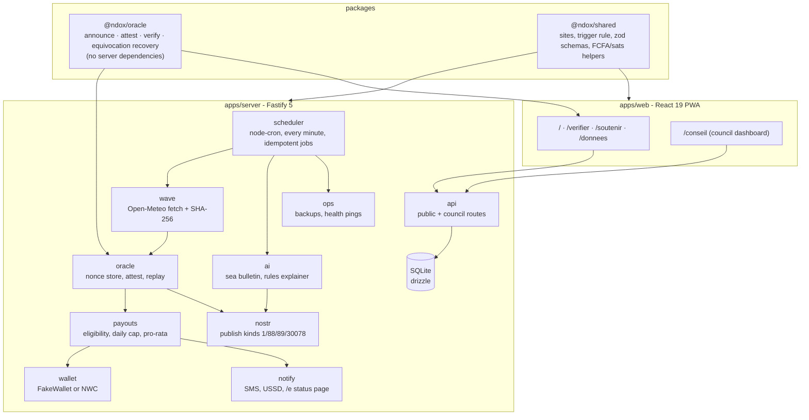

# Architecture

One container serves the API, the web app and the scheduler. State lives in one SQLite file.

## The daily loop

The scheduler ticks every minute and runs whichever job is due. Every job can be re-run safely, including after a crash mid-job.

| Time (GMT)        | Job      | Result                                                                                                                                                                                                    |
| ----------------- | -------- | --------------------------------------------------------------------------------------------------------------------------------------------------------------------------------------------------------- |
| 20:00, day before | announce | Fresh nonce per site, stored encrypted; kind 88 commitment with `R` published.                                                                                                                            |
| 05:00             | fetch    | Both wave models fetched for 06:00–18:00; raw responses and SHA-256 stored.                                                                                                                               |
| 05:15             | attest   | Rule applied; outcome signed with the committed nonce (kind 89); nonce deleted. An existing attestation is never re-signed.                                                                               |
| right after       | pay      | The attestation is verified with the same code the browser uses. On `danger`, each eligible policy is paid once (unique per policy and attestation), within the daily cap, pro-rata if the pool is short. |
| then              | notify   | SMS per paid payout (retries, delivery reports).                                                                                                                                                          |
| 05:30–06:30       | bulletin | One sea bulletin per day (kind 1), AI-written with a template fallback.                                                                                                                                   |
| after each tick   | ops      | Daily SQLite backup (keeps 7); health-check ping when `HEALTHCHECK_URL` is set.                                                                                                                           |

## Keys

| Key                  | Signs                                                                                 | Touches money |
| -------------------- | ------------------------------------------------------------------------------------- | ------------- |
| `ORACLE_SECRET`      | Commitments and attestations (its x-only public key is the oracle's Nostr pubkey)     | No            |
| `DEMO_ORACLE_SECRET` | Replays only (`ndox-replay` tag)                                                      | No            |
| `POOL_SECRET`        | Policy events, payout receipts, sea bulletin                                          | No            |
| NWC connection       | Lightning payments, within a wallet-side budget and the app's `DAILY_PAYOUT_CAP_SATS` | Yes           |

## Public API

| Route                                                                                   | Purpose                                                      |
| --------------------------------------------------------------------------------------- | ------------------------------------------------------------ |
| `GET /api/today`, `/api/sites`, `/api/meta`                                             | Today's state per site, site list, schedule and network      |
| `GET /api/attestations`, `/api/attestations/:id`, `/api/attestations/:id/raw/:model`    | Signed events, with the raw model responses for re-hashing   |
| `GET /api/payouts`, `/api/pool`                                                         | Payouts with preimages; pool balance and coverage            |
| `GET /api/forecast/:site`                                                               | 7-day outlook (same rule, never signed)                      |
| `GET /api/backtest`                                                                     | Backtest and alert-day match                                 |
| `POST /api/sponsor/invoice`, `GET /api/sponsor/invoice/:hash`, `GET /api/sponsor/crews` | Sponsor a crew or the pool over Lightning                    |
| `GET /api/status/:code`, `GET /e/:code`                                                 | Crew status by 6-character code (JSON, and a no-script page) |
| `GET /api/rules`, `POST /api/explain`, `GET /api/bulletin`                              | The rules applied, the AI explainer, the day's bulletin      |
| `GET /healthz`                                                                          | Liveness                                                     |

Council routes live under `/api/admin/*` (session cookie + CSRF token): crews, settings, deposits, replays.

## Data

SQLite tables: `sites`, `settings`, `crews`, `policies`, `announcements`, `forecasts`, `attestations`, `payouts`, `payout_runs`, `deposits`, `fake_invoices`, `notifications`, `bulletins`, `replay_runs`, `job_runs`. Money is stored as integers (sats and FCFA). Phone numbers and Lightning addresses are encrypted at rest.

## Front end

React 19 + Vite + Tailwind 4, a PWA that keeps the home page readable offline. Public pages stay under 120 KB of JavaScript gzipped. The crew page `/e/CODE` is server-rendered, has no script, and stays under 30 KB for 2G.
